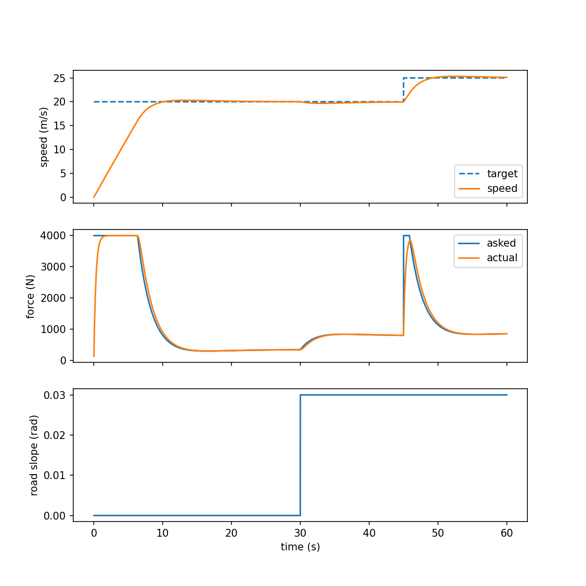
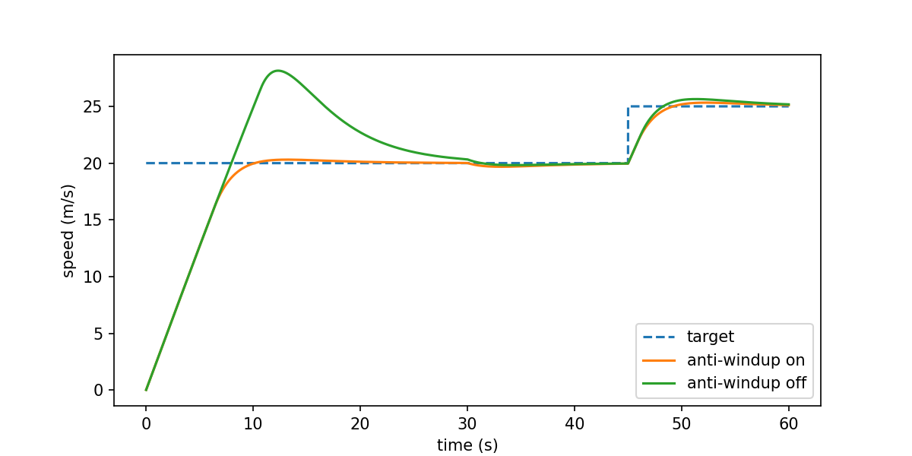

# Cruise Control — Vehicle Model

## Project Overview

This project implements a longitudinal vehicle model in C++17 as the foundation for a cruise control system. The car drives in a straight line, and its speed (m/s) and current engine force (N) change over time. The driver provides a force command, but the engine responds gradually, with a time constant of approximately 0.3 seconds. The model considers aerodynamic drag, tyre rolling resistance, and the effect of road slope on vehicle motion. CMake manages the build process, Google Test verifies the model through unit tests, and GitHub Actions automates building and testing.

### Results

**Step response (`docs/cruise_step.png`)**

The top plot shows speed against the target, the middle plot shows the force the controller asked for against the force the engine delivered, and the bottom plot shows the road slope.



**Anti-windup comparison (`docs/windup_comparison.png`)**

Speed against the target with anti-windup on and off, using the same scenario.



## The 5 Formulas

**1. Air Drag**

Aerodynamic resistance depends on air density, the drag coefficient multiplied by the vehicle's frontal area, and the square of the speed.

```text
air_drag = 0.5 * air_density * cd_a * speed * |speed|
```

**2. Tyre Drag (Rolling Resistance)**

Tyre drag opposes the direction of motion.

```text
tyre_drag = mass * gravity * crr       when speed > 0
tyre_drag = -(mass * gravity * crr)    when speed < 0
tyre_drag = 0                          when speed = 0
```

**3. Road Slope Force**

The slope force depends on vehicle mass, gravity, and the road angle. An uphill slope is positive.

```text
slope_force = mass * gravity * sin(slope_rad)
```

The road angle, `slope_rad`, is measured in radians.

**4. Vehicle Acceleration**

Acceleration is calculated from the engine force and the forces opposing the vehicle's motion.

```text
acceleration = (engine_force - air_drag - tyre_drag - slope_force) / mass
```

**5. Engine Force Rate**

The engine force gradually approaches the requested force according to the engine's response time constant.

```text
engine_force_rate = (force_command - engine_force) / lag
```

The model updates speed and engine force at each simulation time step.

## Vehicle Parameters

| Parameter     | Default Value | Unit  | Description                                 |
| ------------- | ------------: | ----- | ------------------------------------------- |
| `mass`        |          1500 | kg    | Vehicle mass                                |
| `cd_a`        |           0.7 | m²    | Drag coefficient multiplied by frontal area |
| `crr`         |         0.012 | —     | Tyre rolling resistance coefficient         |
| `air_density` |         1.225 | kg/m³ | Density of the surrounding air              |
| `lag`         |           0.3 | s     | Engine response time constant               |
| `gravity`     |          9.81 | m/s²  | Gravitational acceleration                  |

## Unit Tests

The vehicle model is tested using Google Test to verify tyre rolling resistance, engine response delay, and steady-state top speed.

| Test Name      | Initial Setup                                                                                           | Simulation                                     | Expected Result                                                                      | Tolerance |
| -------------- | ------------------------------------------------------------------------------------------------------- | ---------------------------------------------- | ------------------------------------------------------------------------------------ | --------- |
| `TyreDragOnly` | `VehicleParams p;`<br>`p.cd_a_m2 = 0.0;`<br>`Vehicle car(p, VehicleState{20.0, 0.0});`                  | 1000 steps of `car.step(0.0, 0.0, 0.01);`      | `20.0 - 9.81 * 0.012 * 10.0` = **18.8228 m/s**                                       | `1e-9`    |
| `EngineLag`    | `VehicleParams p;`<br>`p.cd_a_m2 = 0.0;`<br>`p.crr = 0.0;`<br>`Vehicle car(p, VehicleState{0.0, 0.0});` | 100 steps of `car.step(1000.0, 0.0, 0.01);`    | `1000.0 * (1.0 - std::exp(-1.0 / 0.3))` ≈ **964.3 N**                                | `5.0`     |
| `TopSpeed`     | `VehicleParams p;`<br>`Vehicle car(p, VehicleState{10.0, 0.0});`                                        | 60,000 steps of `car.step(1500.0, 0.0, 0.01);` | `std::sqrt(2.0 * (1500.0 - 1500.0 * 9.81 * 0.012) / (1.225 * 0.7))` ≈ **55.558 m/s** | `1e-3`    |

### Test Descriptions

* **TyreDragOnly:** Verifies that rolling resistance reduces the vehicle's speed when aerodynamic drag, slope force, and drive force are zero.
* **EngineLag:** Verifies that the engine drive force approaches the commanded force gradually, rather than changing instantaneously.
* **TopSpeed:** Verifies that the vehicle approaches its steady-state speed when the commanded drive force balances aerodynamic drag and rolling resistance.

## Build and Test

Run the following three commands from the project root directory. The project uses CMake, Ninja, a C++17-compatible compiler, and Google Test.

**1. Configure the project**

```bash
cmake -S . -B build -G Ninja -DCMAKE_BUILD_TYPE=Release
```

**2. Build the application and unit tests**

```bash
cmake --build build
```

**3. Run the tests**

```bash
ctest --test-dir build --output-on-failure
```

Google Test reports whether the available vehicle-model tests pass or fail.

## Closed-Loop Cruise Control

The vehicle model is now driven by a PID controller (`pid.hpp`) with optional anti-windup. A simulation program logs a 60-second run to CSV, two Python scripts plot the logs, and a closed-loop test checks the controller against a set of rules.

### New Files

| File                         | Purpose                                                                                         |
| ---------------------------- | ----------------------------------------------------------------------------------------------- |
| `cruise_sim.cpp`             | Runs the closed-loop simulation and writes a CSV log. Usage: `cruise_sim <1 or 0> <output.csv>` |
| `scripts/plot_cruise.py`     | Plots speed against target, asked and actual force, and road slope from one CSV                 |
| `scripts/plot_windup.py`     | Compares speed with anti-windup on and off from two CSVs                                        |
| `tests/closed_loop_test.cpp` | Google Test case `ClosedLoop.MeetsSpec`                                                         |

The first argument of `cruise_sim` switches anti-windup on (`1`) or off (`0`). The CSV columns are `t_s`, `ref_mps`, `speed_mps`, `force_cmd_n`, `force_actual_n` and `slope_rad`.

### Simulation Scenario

| Time        | Event                                     |
| ----------- | ----------------------------------------- |
| 0 s         | Target speed is 20 m/s on a flat road     |
| 30 s        | A 3 percent hill starts (`atan(0.03)` rad) |
| 45 s        | Target speed steps from 20 m/s to 25 m/s  |
| 60 s        | End of simulation (time step 0.01 s)      |

### Closed-Loop Test

| Test Name  | Initial Setup                                                  | Simulation                                                              |
| ---------- | -------------------------------------------------------------- | ----------------------------------------------------------------------- |
| `MeetsSpec` | Default `Vehicle` and default `pid_Config`, target 20 m/s      | 4500 steps of `dt = 0.01` (45 s), with the 3 percent hill starting at 30 s |

The test passes only if all four rules hold:

| Rule | Check                                                          | Limit       |
| ---- | -------------------------------------------------------------- | ----------- |
| 1    | Peak speed (overshoot of at most 1 m/s, 5 percent)             | ≤ 21.0 m/s  |
| 2    | Largest `|speed - 20|` for t in [15, 30] s, before the hill    | ≤ 0.4 m/s   |
| 3    | Largest `|speed - 20|` for t in [40, 45] s, after the hill     | ≤ 0.4 m/s   |
| 4    | Commanded force stays between `u_min` and `u_max` at every step | always true |

### Reproduce the Results

Run these from the project root after building:

```bash
cruise_sim 1 cruise.csv
cruise_sim 0 no_aw.csv
python scripts/plot_cruise.py cruise.csv docs/cruise_step.png
python scripts/plot_windup.py cruise.csv no_aw.csv docs/windup_comparison.png
```

## Out of Scope

The following features are not part of this project stage:

* Gears
* Brakes
* Tyre slip
* PID control
* Plots
